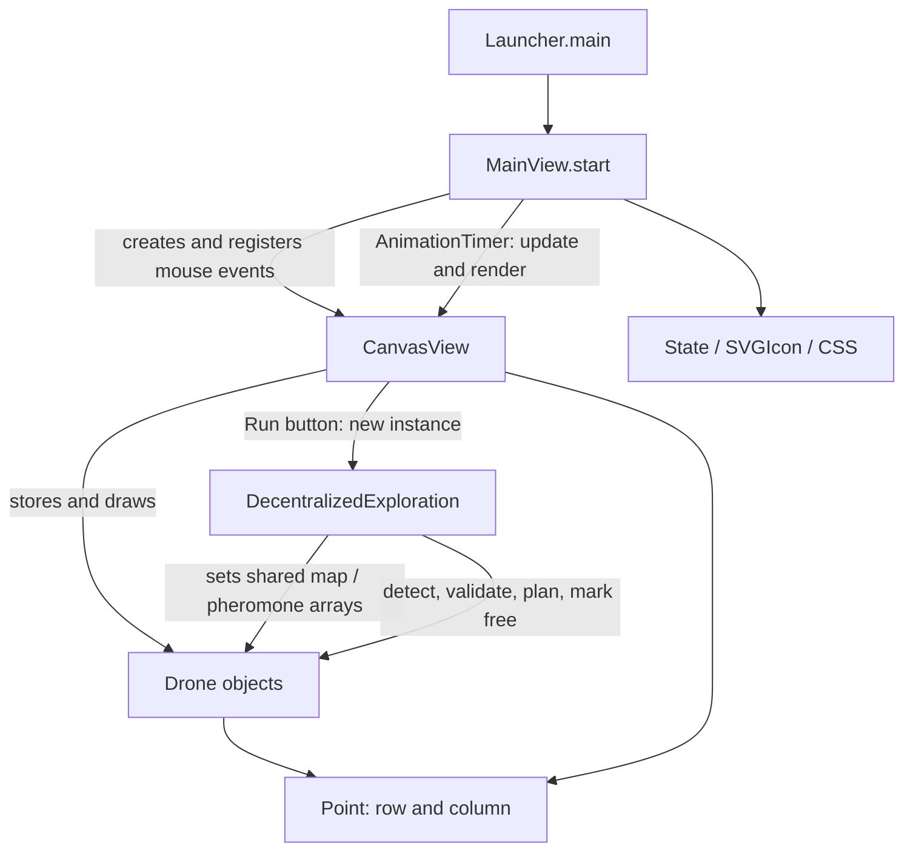

Penyederhanakan/Perampingan source code dasar agar lebih mudah dipelajari kembali

# Decentralized Swarm Coverage Simulator

**Source-code documentation for:** *Decentralized Swarm Coverage Using Frontier-Based Exploration and Repulsive Pheromone Stigmergy*

A Java/JavaFX desktop simulator for designing two-dimensional grid environments, placing multiple simulated drones, visualizing sensing footprints, and running the exploration routine implemented in the accompanying source files.

> **Implementation status:** This README describes the **actual behavior of the uploaded source code**, not every proposed method or experimental claim in the associated research manuscript. In particular, this version is a prototype; it should not yet be described as a fully validated implementation of pheromone-aware frontier utility, decentralized mapping, or A* path planning. See [Research implementation notes](#research-implementation-notes-and-known-limitations).

## Contents

1. [Project structure](#project-structure)
2. [Architecture and class responsibilities](#architecture-and-class-responsibilities)
3. [Execution and method call flow](#execution-and-method-call-flow)
4. [Environment and coordinate model](#environment-and-coordinate-model)
5. [Exploration algorithm: as implemented](#exploration-algorithm-as-implemented)
6. [User interface and controls](#user-interface-and-controls)
7. [Environment file format](#environment-file-format)
8. [Parameters](#parameters)
9. [Build and run](#build-and-run)
10. [Research implementation notes and known limitations](#research-implementation-notes-and-known-limitations)

## Project structure

The nine Java files currently use the package:

```java
package swarmdrone.decentralizedswarmcoverage_ijrcs;
```

With a conventional Maven layout, place them under:

```text
src/main/java/swarmdrone/decentralizedswarmcoverage_ijrcs/
├── Launcher.java
├── MainView.java
├── CanvasView.java
├── DecentralizedExploration.java
├── Drone.java
├── Point.java
├── State.java
├── CSS.java
└── SVGIcon.java
```

The broader runnable project may also include `pom.xml`, Maven wrapper scripts, `module-info.java`, and the `icon.png` resource. **Those build/resource files were not included in this particular nine-file upload.** If reusing `pom.xml` or `module-info.java` from an older repository revision, adjust their module/main-class/package references to match `swarmdrone.decentralizedswarmcoverage_ijrcs` and ensure `icon.png` remains available at the resource path expected by `MainView`.

## Architecture and class responsibilities

The application separates interface setup, grid drawing and interaction, exploration orchestration, and per-drone behavior.

| Class | Responsibility | Important collaborators |
|---|---|---|
| `Launcher` | Java entry point; launches the JavaFX application | `MainView` |
| `MainView` | Builds the window, toolbar, scrollable canvas, log/status panes; routes events and runs the JavaFX `AnimationTimer` | `CanvasView`, `State`, `SVGIcon`, `CSS` |
| `CanvasView` | Stores/editable environment grid and drone list; handles mouse gestures, coordinate transforms, file I/O and rendering; starts exploration | `Drone`, `DecentralizedExploration`, `Point`, `State` |
| `DecentralizedExploration` | Initializes shared algorithm arrays and runs the exploration/search loop, pheromone update and diffusion | `Drone`, `Point` |
| `Drone` | Represents initial/current drone location, path/frontier list, sensing and visualization; implements candidate search/backtracking and pheromone deposition | `Point`, shared arrays provided by `DecentralizedExploration` |
| `Point` | Row/column coordinate value with getters, setters, `equals` and `toString` | `Drone`, `CanvasView`, `DecentralizedExploration` |
| `State` | Enum controlling **editor/UI modes**, not autonomous drone flight modes | `MainView`, `CanvasView` |
| `SVGIcon` | SVG path-data constants for toolbar icons | `MainView` |
| `CSS` | JavaFX stylesheet string for application appearance | `MainView` |

### High-level relationship diagram



### Key distinction: controller vs. model

`MainView` configures the GUI. `CanvasView` owns the on-screen grid, the editable obstacle map and the drone collection. `DecentralizedExploration` conducts the exploration run; each `Drone` stores its own `frontier` and `path` but receives references to **shared** exploration arrays. This detail matters when interpreting the term *decentralized* in the paper.

## Execution and method call flow

### 1. Launch and GUI initialization

```text
Launcher.main(String[] args)
  └── Application.launch(MainView.class, args)
        └── MainView.start(Stage)
              ├── initializeToggleGroup()
              ├── getCanvas() -> new CanvasView(environment, cellSize)
              ├── register mouse and scroll callbacks
              ├── build toolbar, scrolling canvas, log and status areas
              ├── apply CSS.style and SVGIcon symbols
              └── start AnimationTimer
                    ├── CanvasView.update() -> Drone.update()
                    └── CanvasView.render() -> Drone.draw(...)
```

`AnimationTimer` is a **visualization/frame callback**. It does not control the full exploration loop: the exploration algorithm is triggered synchronously when the user clicks **Run**.

### 2. Edit environment and add drones

- `MainView.initializeToggleGroup()` maps toolbar selections to `State` values on `CanvasView`.
- `CanvasView.handleMouseClicked()` toggles obstacles (`0` ↔ `-1`), adds a `Drone`, or removes a drone at its initial grid coordinate depending on editor mode.
- `CanvasView.handleMousePressed()`, `handleMouseDragged()` and `handleMouseReleased()` implement dragging, line-based obstacle editing and panning.
- `CanvasView.handleMouseScroll()` zooms around the mouse position by updating scale and camera translation.
- `CanvasView.checkWallType()` recalculates obstacle-edge markings after edits.
- `CanvasView.render()` draws the grid, obstacle shading/hatching, preview line, previously generated paths and drone icons/visibility regions.

A small drag threshold helps prevent a drag/zoom gesture from being interpreted as an unintended add/remove click.

### 3. Click Run: exact call chain

```text
MainView.handleButtonRun(...)
  └── CanvasView.run()
        ├── getBorders()              // bounding rectangle of obstacle cells
        ├── getActiveDrones()         // filter drone positions against bounds; label D1, D2, ...
        └── new DecentralizedExploration(environment, drones, bounds)
              └── constructor invokes run()
                    ├── initializeMap()
                    │     ├── copy environment -> shared map
                    │     ├── getUnknownArea() (8-neighbor BFS from initial drone cells)
                    │     └── initialize shared pheromoneGrid
                    ├── inject shared arrays into each Drone
                    │     ├── setNeighbors(), setMap()
                    │     ├── setMustBeExploredArea()
                    │     ├── setPheromoneGrid(), setDeltaTau()
                    │     ├── initializePosition()
                    │     └── setFree(initial position)
                    └── loop while a frontier remains
                          ├── for each drone:
                          │     ├── detectFrontiers()
                          │     ├── frontierValidation()
                          │     ├── isThereStillAFrontier()
                          │     └── pathPlanningToTheNearestFrontier()
                          ├── update global pheromoneGrid
                          ├── diffuse global pheromoneGrid
                          └── replace deltaTau and inject it into each Drone
```

After the exploration constructor returns, `CanvasView.run()` calls `render()`. `Drone.path` is then available for drawing. The `Drone.visualization` variable (`READY`, `PLAY`, `PAUSE`, `REPLAY`) is distinct from the editor `State` enum; in the current `MainView`, Play/Pause and Replay buttons do not yet change it.

## Environment and coordinate model

The simulator uses a two-dimensional integer grid addressed as `[row][col]`:

| Data/value | Interpretation in the current code |
|---|---|
| `environment[row][col] == -1` | Obstacle / wall |
| `environment[row][col] == 0` | Free cell in the editor / initially unmarked in the exploration map |
| `map[row][col] == 1` | Marked as observed/explored by `Drone.setFree()` |
| `mustBeExploredArea[row][col] == 1` | Free area reachable in the code's bounded 8-neighbor flood fill |

`CanvasView.environment` describes the edit-time layout. `DecentralizedExploration.initializeMap()` **copies** this array to an algorithm map, so marking explored cells does not directly overwrite the editor layout.

Coordinate convention:

- `row` indexes Y (downward on the screen); `col` indexes X (rightward).
- World position of the cell center: `x = col * cellSize + cellSize / 2`, `y = row * cellSize + cellSize / 2`.
- Screen mapping: `screenX = worldX * scale + translateX`, `screenY = worldY * scale + translateY`.
- Mouse events invert this mapping before computing cell indices.

Default editor settings are `200` rows × `400` columns with `cellSize = 10` **display units**. No real-world meters-per-cell calibration is defined in the uploaded files.

## Exploration algorithm: as implemented

### Initialization and reachable-area mask

`DecentralizedExploration.getUnknownArea()` performs a queue-based breadth-first traversal using eight neighboring offsets (including diagonals). It labels free cells reachable from each initial drone location **within the rectangular bounds computed from obstacles**. This mask also restricts pheromone updates and the per-drone sensing routines. It is distinct from a dynamically learned occupancy map.

### Frontier collection

`Drone.detectFrontiers()` uses ray stepping around the end of the current path to append unknown cells to that drone's `frontier` list. `frontierValidation()` removes candidates marked explored or outside the exploration mask; duplicates are checked using `Point.equals()`.

**Important:** The current candidate definition is the implementation's ray-detected unknown cells, not necessarily the textbook set of *known free cells adjacent to unknown cells*. This distinction should be preserved in research reporting until the algorithm is explicitly revised.

### Candidate search, routing and sensing

`Drone.pathPlanningToTheNearestFrontier()` uses a `Stack<Point>` and a visited list to explore eight-connected neighbor candidates with backtracking. It evaluates adjacent candidates using an inverse-distance heuristic and an inverse-pheromone expression, then chooses the **largest calculated score**; roulette-wheel selection appears only in a commented-out block. This is a stack-based heuristic search, **not an A* implementation**.

When a frontier is reached, intermediate stack positions are appended to `Drone.path`, and `setFree()` performs ray-based exploration updates and increases `deltaTau` for observed cells. More frontier detection/validation occurs along these path positions.

### Pheromone arrays

The exploration controller initializes `pheromoneGrid` with `1.0` on reachable cells and allocates `deltaTau`. Each drone receives references to both arrays. `Drone.setFree()` adds `Q` to the accumulator for ray-observed cells. Following each outer iteration, the controller updates pheromone values and applies neighborhood-based diffusion before resetting the deposit accumulator.

The present update statement in `DecentralizedExploration.run()` is:

```java
double tau = (1.0 - rho) * pheromoneGrid[i][j] + deltaTau[i][j];
pheromoneGrid[i][j] += tau;
```

Therefore, the executed recurrence **before diffusion** is `P_next = (2 - rho) * P_old + deltaTau`, rather than the conventional evaporation recurrence `P_next = (1 - rho) * P_old + deltaTau`. This README documents the source code as written; **no algorithm changes have been made**.

## User interface and controls

| Toolbar item / gesture | Current function |
|---|---|
| New Environment | Reset map, camera and drone collection |
| Open Environment | Load an environment and initial drone coordinates |
| Save Environment | Save map and initial drone coordinates to file |
| Transform | Return to default editor mode; left-drag can reposition a drone |
| Add Drone | Add a drone by a single primary-button click |
| Remove Drone | Remove an initial-position-matching drone by click |
| Wall | Toggle a wall cell on click |
| Draw Line | Drag to create a line of obstacle cells |
| Remove Line | Drag to erase cells along a line |
| Mouse wheel | Zoom around pointer (`scale` clamped to `0.1–20.0`) |
| Middle-button drag | Pan the view in any tool mode |
| Run | Perform exploration via `CanvasView.run()` |
| Play/Pause | Button exists, but its handler currently only sets the editor state to default |
| Replay | Button exists, but its handler currently only sets the editor state to default |

**Display:** `CanvasView.render()` draws gray grid lines, turquoise walls, path lines, orange sensing overlays, drone symbols and position labels. `Drone.drawCameraVisibility()` and `Drone.drawSensoreVisibility()` render visual sensor footprints; algorithmic sensing is implemented separately.

## Environment file format

The editor offers `.sc` as a file extension and writes a colon-delimited text representation. The writer produces a header, grid dimensions, one colon-separated row per grid row, and an optional drone section:

```text
ENVIRONMENT----------------------------------
NUM ROWS:3
NUM COLS:4
0:0:-1:0:
0:0:-1:0:
0:0:0:0:
DRONES---------------------------------------
NUM DRONES:1
1:1
```

The saved drone coordinates are **initial** `row:col` positions, not the trajectory or simulation results. The file reader assumes a particular header layout, so treat compatibility with existing `.sc` files as part of regression testing. The current reader should also be audited for behavior when the optional drone section is missing.

## Parameters

Values below are taken directly from the uploaded Java source, not from an independently validated experiment.

| Location | Parameter | Current value | Purpose |
|---|---|---:|---|
| `MainView` | rows × columns | `200 × 400` | Default grid |
| `MainView` | `cellSize` | `10` | Grid rendering size |
| `CanvasView` | `sensorFoV` | `4` cells | Passed to each new drone |
| `CanvasView` | `cameraFoV` | `3` cells | Passed to each new drone |
| `CanvasView` | min/max zoom | `0.1 / 20.0` | UI camera limits |
| `CanvasView` | zoom factor | `1.05` | Wheel zoom ratio |
| `CanvasView` | drag threshold | `4.0` screen pixels | Click-vs-drag distinction |
| `DecentralizedExploration` | `rho` | `0.05` | Pheromone update coefficient |
| `DecentralizedExploration` | `D` | `0.1` | Diffusion mixing coefficient |
| `Drone` | `Q` | `1.0` | Deposit increment in `setFree()` |
| `Drone` | `alpha` | `0` | Exponent applied to inverse pheromone |
| `Drone` | `beta` | `1` | Exponent applied to distance heuristic |
| `DecentralizedExploration` | neighborhood | 8-connected | BFS, search and diffusion |

**Note:** `alpha = 0` makes `Math.pow(tau, alpha)` equal to `1` for positive `tau`, so pheromone **does not influence the current candidate score** under the default parameters. `P_max` appears in comments but is not implemented as a cap.

## Build and run

The application requires Java and JavaFX. The previously supplied Maven project uses JavaFX `21.0.6` and Maven Compiler Plugin targeting **Java 24**. Confirm the Java version and build configuration in the `pom.xml` committed alongside this README.

If the GitHub repository includes the Maven wrapper and the JavaFX Maven plugin:

```bash
# Windows
mvnw.cmd clean javafx:run

# Linux / macOS
./mvnw clean javafx:run
```

Alternatively, open the Maven project in IntelliJ IDEA and launch `Launcher.main()` with its JavaFX dependencies configured.

**Package compatibility checklist:** because the nine files in this upload declare `swarmdrone.decentralizedswarmcoverage_ijrcs`, update any older `pom.xml` plugin `mainClass`, `module-info.java` exports/opens/module identity, and the on-disk source directory accordingly. Do not copy older project metadata unchanged if it points to `swarmdrone.decentralizedswarmcoverage`.

`MainView` also loads `icon.png` via `getResourceAsStream("icon.png")`; ensure the resource is packaged in the same Java package resource location.

## Research implementation notes and known limitations

These notes are intentionally transparent so the repository is useful for source-code study and does not overstate the present state of experimental validation.

1. **Shared arrays, not per-agent local maps.** The controller supplies the same `map`, `pheromoneGrid`, `mustBeExploredArea`, and `deltaTau` references to every drone. Decision methods are called separately for each drone, but the current implementation does not demonstrate independently maintained local occupancy maps or a physically realizable pheromone-sharing mechanism.
2. **No operational pheromone effect at the default exponent.** `Drone.alpha = 0` neutralizes the inverse-pheromone factor in adjacent candidate ranking.
3. **Pheromone update differs from the usual evaporation formula.** The `+= tau` assignment adds the previous pheromone value again. It may increase concentrations rather than evaporate them as intended.
4. **Stack search is not A*.** The current planner uses a depth-first/backtracking structure and a local candidate score. There is no A* open set, `g` cost, or `f = g + h` evaluation.
5. **No implemented information-gain frontier utility.** There is no explicit normalized information-gain/travel-distance/local-pheromone score matching the complete utility described in the manuscript.
6. **Frontier representation requires review.** The implementation collects ray-encountered unknown cells; this may differ from the paper's formal free/unknown frontier boundary definition.
7. **Exploration and playback have different timing.** The `DecentralizedExploration` constructor runs its search synchronously. `AnimationTimer` redraws and calls `Drone.update()`, but the toolbar Play/Pause and Replay handlers do not yet control the drone's visualization variable.
8. **No experiment metrics exporter.** Coverage ratio, revisit rate, overlap rate, seeds, repetitions and statistics are not logged/exported by the provided nine classes.
9. **No validated physical robot interface.** The uploaded files implement a JavaFX grid simulator, not an interface to physical UAV flight controllers or real localization systems.
10. **Practical robustness considerations.** The ray-casting loops use very small step increments; large environments may be computationally expensive. In addition, `Point` overrides `equals()` but not `hashCode()`, relevant if future code uses hash-based collections.

These are **documentation findings only**. They are **not fixes or newly added drone operations**. Future changes should be implemented, benchmarked and tracked separately from this source-code documentation revision.

## Recommended reading order

For a developer revisiting the project after some time:

1. `Launcher.java` → see how the application starts.
2. `MainView.java` → understand buttons, modes and canvas event wiring.
3. `State.java`, `SVGIcon.java`, `CSS.java` → understand GUI support code.
4. `CanvasView.java` → follow edit, save/load, `render()` and `run()`.
5. `Point.java` → understand how grid coordinates are represented.
6. `DecentralizedExploration.java` → trace shared array initialization and the search loop.
7. `Drone.java` → inspect frontier sensing, candidate search, `setFree()`, trajectory storage and drawing.

---

**Research context:** The accompanying manuscript studies frontier-based swarm exploration and repulsive digital pheromone stigmergy. This repository documentation records the current software prototype and provides a foundation for later, separately reviewed algorithm and experimental improvements.

